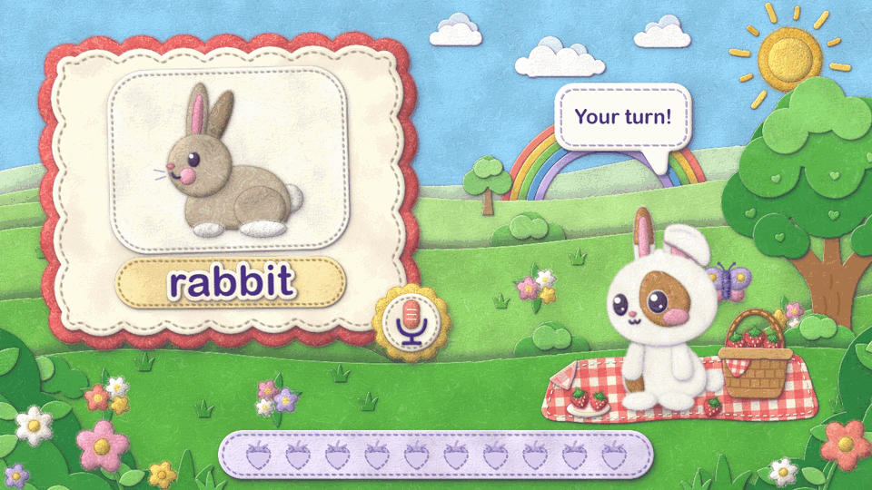
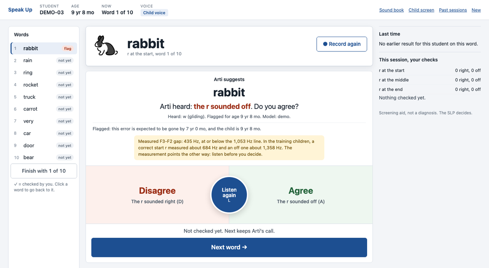
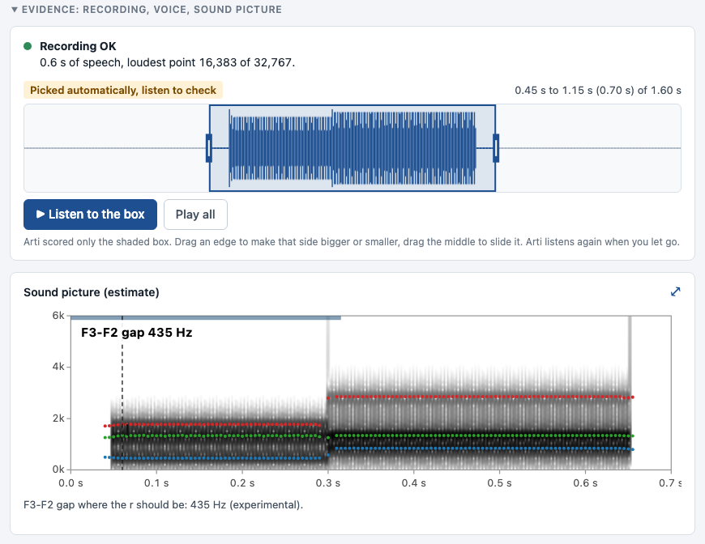
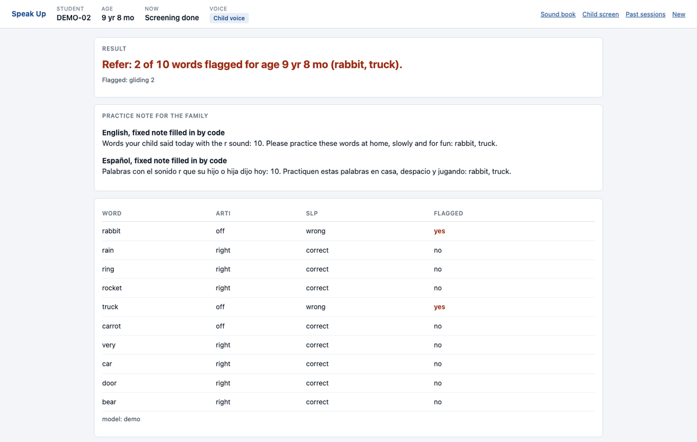

# Speak Up | HackEdge 2026

[](https://godfreyponce.github.io/speakup-hackedge-2026/)

Project page with screens from the app and how it works: https://godfreyponce.github.io/speakup-hackedge-2026/

The report we submitted: [docs/SpeakUp_Report.pdf](docs/SpeakUp_Report.pdf)

Speak Up is an offline speech screening aid for school speech-language pathologists (SLPs), and it runs on a Texas Instruments SK-AM62B board. A child says short words with the /r/ sound, a small model on the board (Arti) judges each r, and the SLP checks every call. At the end the SLP gets a tally and a short note written by a language model on the same board. There is no network and no cloud, and no audio leaves the board. Speak Up screens and monitors, it never diagnoses, and the SLP makes every decision.

Event: UTD HackEdge 2026 (UT Dallas ECE and Texas Instruments), Track 3: Edge AI Assistant

## Team

| Who | Studies | Built |
|---|---|---|
| Godfrey Ponce | Computer science | The app, the language-model features, the practice coach, the write-up |
| Rafael Amador | Computer engineering | The hardware (board, microphone, setup), the model experiments |
| Alexis "Lexi" Marsh | Speech, Language & Hearing Science and Child Development | Clinical design, the word list, the wording the SLP sees |

## What it looks like

These are screenshots of demo mode (`python3 -m speakup --demo`), so every result comes from the fixed script and no real child's data is in them.



The child view on the HDMI screen while the microphone listens: the word, its picture and the buddy.



The SLP view after a word: Arti's call, the measured F3-F2 gap next to the line from the training children, and the SLP's Agree or Disagree.



The evidence under each call: the part of the recording Arti scored and the sound picture with the F3-F2 gap, here on a synthetic test clip made for the screenshot.



The end screen: the tally, the fixed family note in English and Spanish, and Arti's call next to the SLP's for each word (here the SLP overrode Arti on carrot).

## Quick start (laptop, no model needed)

Demo mode answers from a fixed script instead of the model and the microphone, so you can try it anywhere Python runs.

```bash
git clone https://github.com/godfreyponce/speakup-hackedge-2026.git
cd speakup-hackedge-2026
python3 -m pip install numpy
python3 -c "from speakup import synth, synth_book; open('rabbit.wav','wb').write(synth.wav_bytes(synth_book.audio('w-rabbit','girl10')))"
python3 -m speakup --demo --sample-clip rabbit.wav
```

The second line makes `rabbit.wav` with the app's own speech synthesizer (`speakup/synth.py`): a computer-made "rabbit", not a recording of anyone. With it, each word gets the full SLP view: the measured F3-F2 gap, the waveform, the sound picture and Listen again. The r call itself still comes from the demo script, not from Arti, so only the sound analysis is real. Plain `python3 -m speakup --demo` also works, without the sound analysis.

On Windows, use `py` in place of `python3`.

Then open these in a browser:

| Page | What it is |
|---|---|
| http://localhost:8000/ | The SLP view: start a session, see each call, agree or disagree (keys A, D, L to listen again) |
| http://localhost:8000/kid | The child view with the buddy, the word and its picture (on the board this is the HDMI screen) |
| http://localhost:8000/sessions | Finished sessions |
| http://localhost:8000/book | The Sound Book: computer-made example sounds and their pictures |
| http://localhost:8000/look | Choose the child view's look |

Enter a date of birth at least 8 years ago so every scripted error gets flagged. To try the sound analysis on your own recording, pass any WAV file to `--sample-clip`.

## Dependencies

| Where | What | Why |
|---|---|---|
| Laptop and board | Python 3.12 or newer (the board image ships 3.14) | The app (standard library web server, no framework) |
| Laptop and board | `numpy` | Sound analysis |
| Board (or laptop with a model) | `onnxruntime` | Runs Arti, the r-sound model |
| Board | `arecord` (ALSA, in the TI image) | Records from the USB microphone |
| Board, optional | [llama.cpp](https://github.com/ggml-org/llama.cpp) `llama-completion`, built on the board | The end-of-session note (Qwen2.5-0.5B-Instruct, 4-bit) |
| Training only (laptop with a GPU) | `torch`, `torchaudio`, `onnx`, `onnxscript` | Training and exporting Arti, not needed to run the app |

Without onnxruntime the app still runs in demo mode, and without llama.cpp the end screen shows the tally only.

## Results

- Arti v2 (soft labels, the model we ship) agrees with trained listeners on 268 of 300 clips (89%) from 55 children it never saw in training. Arti v0 got 258 and the F3-F2 gap alone got 214.
- On all 21,591 clips from those children, Spearman with the listener share is 0.624 (v0: 0.593), and in an offline check Platt scaling cut calibration error from 0.107 to 0.026 (not applied in this build: the app uses a fixed 0.5 cut).
- On the board Arti v2 takes 46.7 ms per clip on one thread and 72 MB of memory. The app runs it on one thread: with four threads on a busy board (language model and child view running) it took 109 ms. The language model runs at 4.6 tokens per second, so the app builds the note from approved sentences and code checks every number in it.
- In practice mode, after a miss the next word comes from the r position the child misses most, and the child sees a tip for the error the SLP marked (gliding, distortion) or for the r position. Qwen rewords the approved tips and code checks every rewording. The tips stay drafts until Lexi approves them.

Details are in [docs/test-set.md](docs/test-set.md), [docs/model-timing.md](docs/model-timing.md) and [docs/architecture-comparison.md](docs/architecture-comparison.md).

## Run on the SK-AM62B board

### Hardware

| Item | Notes |
|---|---|
| TI SK-AM62B | AM62x: 4 Arm Cortex-A53 cores, 2 GB RAM, no AI accelerator |
| microSD card, 32 GB or more | TI Processor SDK Linux AM62x 12.01.00.05.03 image |
| USB-C power supply, 5 V / 3 A | Into J11 |
| USB microphone | We use an Audio-Technica ATR2100-USB, on a powered USB hub |
| Ethernet cable | Laptop to board, direct (you open the SLP view on the laptop) |
| HDMI monitor | The child view |

### Setup

[docs/board-setup.md](docs/board-setup.md) walks through flashing the card, the serial console, the network, SSH, the microphone and the monitor, with the problems we hit and how we fixed them.

On the board, check the Python modules (all of them come with the TI image):

```bash
python3 -c "import onnxruntime, numpy, sqlite3"
```

Copy the app and the model from the laptop (see [Models](#models) for the model file):

```bash
ssh <board> mkdir -p speakup-app/models
scp -r speakup scripts <board>:speakup-app/
scp models/arti-v2-soft.onnx <board>:speakup-app/models/
scp models/qwen2.5-0.5b-instruct-q4_k_m.gguf <board>:speakup-app/models/   # optional, for the note
```

For the end-of-session note (optional), build llama.cpp on the board and download the Qwen model as in [docs/model-timing.md, "llama.cpp and the end screen's note"](docs/model-timing.md#llamacpp-and-the-end-screens-note-9).

### Run

```bash
cd speakup-app
python3 -m speakup --arecord --device plughw:0,0 --arti models/arti-v2-soft.onnx \
    --llm-bin ~/llama.cpp/build/bin/llama-completion --llm-model models/qwen2.5-0.5b-instruct-q4_k_m.gguf
```

- `--device` is the microphone's ALSA device (`arecord -l` lists them, ours is `plughw:0,0`).
- Leave out `--llm-bin` and `--llm-model` to run without the note.
- Open `http://<board-ip>:8000/` on the laptop for the SLP view and `http://localhost:8000/kid` on the board's monitor.
- With no microphone, `--replay <folder>` uses saved clips (one per word on screen) in place of `--arecord`.
- Every other option is in `python3 -m speakup --help`.

## Models

| Model | Size | Where it comes from |
|---|---|---|
| Arti v2 (`arti-v2-soft.onnx`) | 1.27 MB, ~81,000 parameters | Trained by us on the PERCEPT-R corpus: BC-ResNet body, soft labels for clips listeners disagreed on ([docs/arti-v2-experiment.md](docs/arti-v2-experiment.md)) |
| Qwen2.5-0.5B-Instruct, Q4_K_M | 491 MB | Public download from Hugging Face |

Arti is not in this repo and we can't give out copies. It's trained on PERCEPT-R, which TalkBank distributes, and TalkBank asked us (Nov 13, 2026) not to share models trained on its data publicly. They allow them in a competition demo only if no one keeps a copy. The app still runs without Arti in demo mode (`--demo`, see the quick start). To build your own Arti:

1. Get the PERCEPT-R corpus from TalkBank/PhonBank with a free account (doi:10.21415/0JPJ-X403).
2. Pick the held-out test set, then train and export (about 16 minutes on a laptop GPU, plus about 4 for the feature cache):

```bash
python3 -I scripts/pick_test_set.py data/percept-r/PERCEPT-R.zip
uv run --managed-python --python 3.12 --with torch --with torchaudio --with onnx --with onnxscript \
    --with onnxruntime --with numpy python -I scripts/experiment_arti_soft.py data/percept-r/PERCEPT-R.zip --seed 2028 \
    --out models/arti-v2-soft.onnx
```

To get Qwen:

```bash
uv run --managed-python --with huggingface_hub hf download Qwen/Qwen2.5-0.5B-Instruct-GGUF \
    qwen2.5-0.5b-instruct-q4_k_m.gguf --local-dir models
```

Arti's input is 1.5 s of 16 kHz audio as 40 log-mel bands (25 ms windows, 10 ms hop). How the shipped model was chosen is in [docs/arti-v2-experiment.md](docs/arti-v2-experiment.md); the first version (v0) and its training are in [docs/model-timing.md](docs/model-timing.md#how-arti-was-trained).

## Tests

```bash
python3 -m pip install numpy
python3 -m unittest discover -s tests
```

A few tests fake `arecord` and `llama-completion` with shell scripts, so they only pass on Linux or macOS. On Windows those (about 13) show as errors.

## Data and privacy rules

- Never commit audio recordings, child data or trained models. Git ignores `data/`, `recordings/` and `models/`.
- Recordings and sessions stay on the machine that runs the app (`recordings/`, `data/speakup.db`).
- Wording, accents and dialects: [docs/research/fairness-and-wording.md](docs/research/fairness-and-wording.md).

## What is where

| Path | What |
|---|---|
| `speakup/` | The app: web server and pages (`server.py`, `pages.py`), recorder, Arti (`arti.py`), sound analysis (`acoustics.py`), sessions, the language-model note (`llm.py`, `summary.py`), practice lines (`bank.py`, `practice.py`) and the coach (`coach.py`) |
| `speakup/static/` | Child-view art and scripts |
| `scripts/` | Training, test-set picking, timing on the board |
| `tests/` | Unit and server tests |
| `docs/board-setup.md` | Board setup from a blank card |
| `docs/model-timing.md` | Model choice, sizes, timing, how Arti was trained |
| `docs/test-set.md` | The 300-clip held-out test set and its rules |
| `docs/arti-v2-experiment.md` | How Arti v2 (the shipped model) was chosen |
| `docs/architecture-comparison.md` | Arti versions compared on accuracy, board time, memory and energy |
| `docs/research/` | Data and licences, fairness and wording, the /s/ sound, recruiting, the Round 3 plan ([index](docs/research/README.md)) |
| `docs/round3-demo-script.md` | The final demo, step by step |
| `docs/round3-log.md`, `docs/HISTORY.md` | Decisions from the Round 3 build, and what each finished ticket built |

## Planned next (not in this build)

None of this is in the code being judged. These are plans, in the order we expect to do them.

- A camera tie-breaker on a Raspberry Pi 5 with a Hailo AI accelerator (or a plain camera module) that reads mouth landmarks. A camera can see lip rounding (a child gliding, saying /w/ for /r/) and a frontal lisp, but it can't see a lateral lisp or the tongue shape of /r/, so it only helps break ties. It never stores frames, and the SLP still decides.
- One board instead of two: a TI AM62A (2 TOPS accelerator) for audio and camera, with an XMOS microphone array for clean audio in noisy classrooms.
- A model we can share, retrained on CC BY data only (JIBO Kids, Speechocean762).
- Naming the error type (gliding, distortion), then a phone recognizer that finds sounds inside sentences, then sounds beyond /r/.
- Our own recordings, with a faculty lead and IRB approval, adult volunteers first and then children ([recruiting](docs/research/recruiting.md)).
- A fairness target: false-alarm rates per accent group under 5 percentage points apart ([fairness](docs/research/fairness-and-wording.md)).
- Lexi and a practicing SLP approve every practice-coach tip.

## References

- Benway, N. R., et al. (2023). PERCEPT-R classifier. *Journal of Speech, Language, and Hearing Research*. doi:10.1044/2023_JSLHR-22-00343
- Benway, N. R., et al. (2022). The PERCEPT-R corpus. *Proc. Interspeech 2022*, 3648-3652. doi:10.21437/Interspeech.2022-10785
- PERCEPT-R Corpus, TalkBank. doi:10.21415/0JPJ-X403
